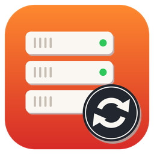

<p align="center"></p>

# AADAS - Auto Array Detection & Swap

**An Unraid plugin for servers that hold more than one set of disks. At boot it detects which set is installed and applies that set's array configuration.**

> **Status: 0.1.0 RC1 (plugin version `2026.11.19e`) - release candidate.** It runs on one server and has passed isolated tests of the boot and rollback paths. Read [Testing](#testing) before you rely on it, and keep a flash backup.

## Why
Unraid keeps one array configuration. If you swap whole sets of disks in the same chassis, for example a media set and a backup set, every swap means reassigning slots, pools and shares by hand. One wrong click starts the array with the wrong disks, or offers to format them.

AADAS saves the configuration of each set and switches between sets as one unit. A saved set contains:
- the slot assignment (`super.dat`)
- the pool configs (`pools/*.cfg`)
- the share configs (`shares/*.cfg`)
- the share list of the *Custom SMB Shares* plugin, if it is installed

## Features
- **Detect at boot** (optional, off by default): before Unraid reads its configuration, AADAS applies the one saved set whose disks are installed *exactly*. The boot flash, global pools and ignored disks do not count.
- **Safe by default:** AADAS changes nothing when anything is unclear. That includes missing, extra, unknown or mixed disks, two matching sets, or an incomplete set. Array autostart is held and a notification says why.
- **Verified switch:**
  1. Array autostart is held first.
  2. A backup of the live configuration is written with SHA-256 checksums and checked.
  3. The target is staged, and a journal records each phase.
  4. The live files are replaced and compared.

  A failed switch is rolled back at once, an interrupted one at the next boot.
- **Preview:** the page shows what the next boot would do and why, with every disk and the set it belongs to. The preview is read-only.
- **Save on stop:** the active set is saved when the array stops, but only if exactly its disks are installed.
- **Global pools** (for example a cache SSD) stay in place for every set.

## Install
Unraid 7.0 or newer. In the web UI, open *Plugins → Install Plugin*, paste the URL and click *Install*:
```
https://raw.githubusercontent.com/AtomicRelaxed/unraid-aadas/main/aadas.plg
```

## Use
Open *Utilities → AADAS - Auto Array Detection & Swap*.
1. Set **global pools**: pools that are never swapped, such as a cache SSD. They live in `GLOBAL_POOLS` in `/boot/config/aadas/global.cfg`.
2. **Save** the current set under a name, for example `MEDIA`.
3. Prepare the other set with *Switch → new set*. After the reboot, assign its disks and save it, for example as `BACKUP`.
4. From then on you can either switch by hand (*Switch*, then reboot), or turn on **Detect the installed set at boot** and just swap the disks.

**Never format a disk because a set was not applied.** Check the notification and the *Next boot* preview first.

### Command line
`bash /boot/config/aadas/aadas.sh <command>`

| Command | Effect |
|---|---|
| `status` | active and pending set, settings, detected set |
| `list` | saved sets and which disks are missing |
| `plan` | read-only preview of the next boot decision |
| `check` | compare the installed disks with the active set |
| `save [name]` | save the current configuration as a set |
| `switch <name>` | switch at the next boot (array stopped) |
| `switch new <name>` | start an empty new set at the next boot |
| `rename <old> <new>` | rename a set |
| `delete <name>` | delete a set; it is moved to `backups/` |
| `set detect yes\|no` | turn detection at boot on or off |
| `set save_on_stop yes\|no` | turn saving on array stop on or off |
| `schedule off\|daily\|weekly` | timed autosave |

## How it works
The plugin adds one line to `/boot/config/go`, just before `emhttp` starts:
```
timeout 60 bash /boot/config/aadas/aadas.sh boot || true
```
At that point the array configuration has not been read yet, so a set can be applied safely. Everything AADAS stores is in `/boot/config/aadas/`: the sets in `profiles/`, the backups in `backups/`, and a log. Uninstalling removes the `go` line and keeps the saved sets.

## Testing
`tests/` contains fixture tests that run the script in an isolated namespace (`bwrap`), with synthetic disks and a synthetic flash:
```
python3 tests/boot_plan_fixtures.py src/aadas.sh
python3 tests/boot_apply_fixtures.py --sha256 $(sha256sum src/aadas.sh | cut -d' ' -f1) src/aadas.sh
```
- **Plan tests (12):** the decision for each disk inventory, including missing, extra, ambiguous and dangling disk links, and a set that collides with a global pool. These tests also check that previews write nothing.
- **Apply tests (8):**
  - a normal switch
  - a missing autostart setting
  - rollback from a complete, missing or empty backup
  - an SMB list that was absent before the switch
  - recovery after an interrupted backup or stage phase

Not tested yet: a real power loss during a switch, other Unraid versions than 7.3.4, and more than two sets.

## Build
`python3 build_plg.py <version>` writes `aadas.plg` from `src/` and `CHANGES.md`. Versions use the Unraid date scheme `YYYY.MM.DD`, because the plugin manager compares versions as plain strings.

## Support
Please report problems in the [GitHub issues](https://github.com/AtomicRelaxed/unraid-aadas/issues). Attach `/boot/config/aadas/aadas.log` and the output of `aadas.sh plan`.

## Credits
Idea, hardware and testing: AtomicRelaxed. Implementation: Anton (Claude, Anthropic). Code review and fixture tests: Konrad (Codex, OpenAI).

## License
GPLv3 or later, see [LICENSE](LICENSE). © 2026 AtomicRelaxed
